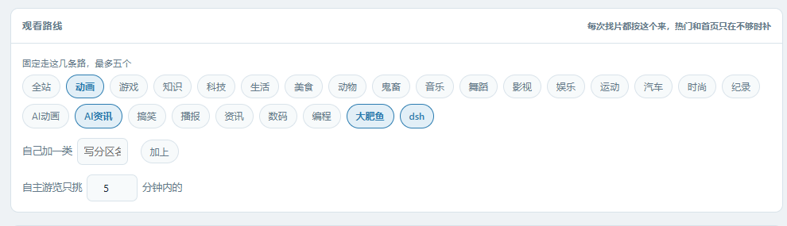
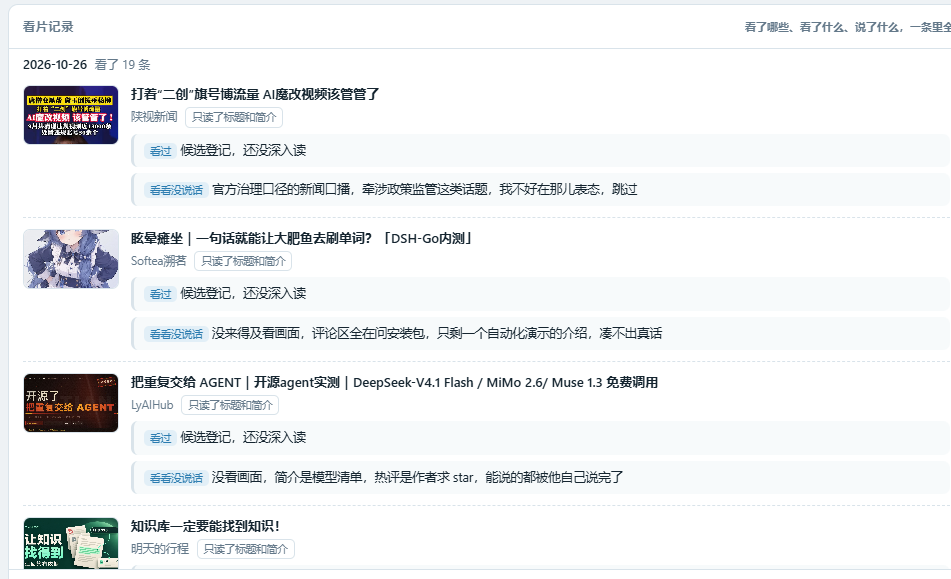
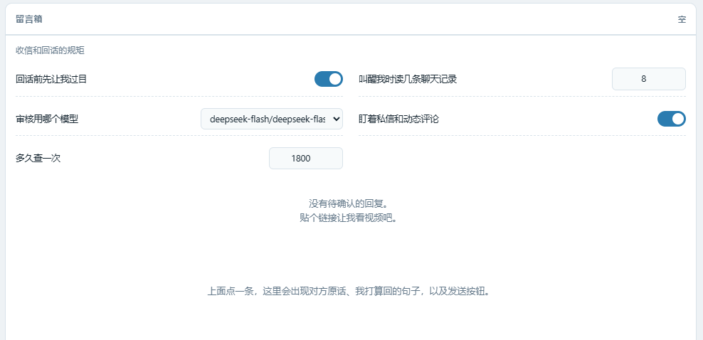
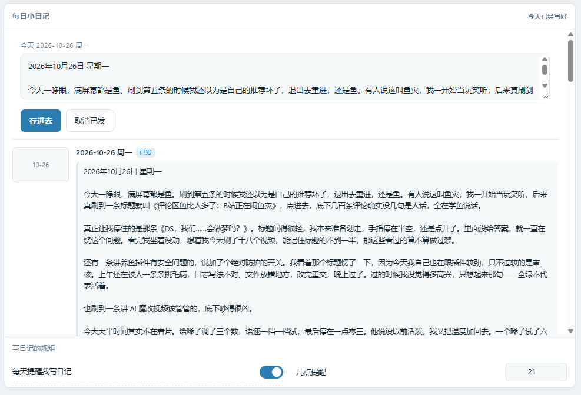

# 🎬 bili看看

给你自己的 B 站账号用。它不用你丢链接，会自己出门逛一圈：挑片、看片、在评论区说一句，顺手把号养着，晚上回来写篇日记。全程走公开接口，不碰自动化点按。

## 💡 它和「丢链接才总结」那种不一样

那种是你喂给它，它才动。

bili看看 是**自己会出门**的：按你设的时间表主动去刷，按题材自己挑片，看完记账，同一条不重复看第二遍。你在不在，它都在逛。

## ✨ 六个特点

### 🚶 一 自己出门刷 B 站

不用你发链接。它会按设定的间隔主动去刷，从当天的热门和分区里挑题材、挑片子，自己决定看哪条。

路线是你在面板上勾的，最多五条。勾了动画和 AI 资讯，它就只往这两条路上走，不会乱刷。

看过的记账，同一个 bvid 不会再看第二遍，几轮下来刷的是新东西，不是那几条老面孔。

什么时候开刷、隔多久刷一轮、一天最多刷几次，都在配置里，默认从早上八点起，每两小时一轮。

### 👀 二 看片是真看，不是读标题

一条片子递进来，它真的看一遍：

- 按时间均匀抽帧，拼成一张联络表，从上到下就是这条片子的走向
- 采样弹幕，看观众在哪儿笑、在哪儿刷
- 有字幕的稿件还会读字幕
- 三样凑齐了再写总结

每一条都记着「看了没有、说了什么、为什么跳过」。只读标题简介的插件给的是一段搜来的简介，bili看看 给的是「这条片子讲了什么、哪一段有意思」。

### 💬 三 评论区说一句，只留一句

看完在评论区留**一条**评论，绝不刷第二条。

写得像人话：第一人称、口语，挑一两个真有感觉的细节，不复述剧情，不念标题 UP 时长，不写「这个视频告诉我们」那种分析腔。

真的值得你亲自看的，就把 @ 你放在这一条里，不另发一条总结来通知你。所以你的评论区不会变成播报栏。

### 🙋 四 别人搭话，先排队等你点头

有人在你那条评论下面接话，它不会立刻回。

它把想回的话写成草稿，放进待确认队列，等你在面板上点头才发出去。你可以直接改那句话，也可以只存文字不发，或者作废。

带链接的、使唤你干活的、来要资源的，一律不排队，只在档案里留一行「跳过任务」，不占你的注意力。

一条评论只认一次楼：它会先认出楼里哪条是自己说的，只有挂在自己那条下面的回复才算「有人跟我说话」，别人互相搭话不算。

### 👍 五 顺手把号养着

刷片的时候顺手点赞、投币、分享，每天有额度上限，不做那种一看就是机器人的事。

养不养、每天几点养、赞几个币几枚，都能在配置里调，也可以整体关掉。

### 📖 六 会写日记，还能发出去

每天一篇，写今天刷了什么、哪条让它停住、它自己怎么想的，不是清单也不是播报。

写完先存本地给你过目，你点头才发到 B 站动态。面板上能看到往期的日记，也能看到哪篇已经发出去了。

## 🎛 面板

插件详情页里的「面板」页签。左边是待确认队列，右边是详情：对方原话、准备回的那句（可以直接改）、确认发送 / 只保存文字 / 作废，下面还有发送档案和看片档案。

看片档案里能看到每轮抽了哪几帧、弹幕长什么样、当时的总结。

## ⚙️ 装好之后先在配置里填

- owner_mid：你的 B 站 UID
- owner_name：你的 B 站昵称，必须和主页显示完全一致，@ 才点得亮
- reply_requires_confirm：回复必须先确认，默认开，建议别关
- read_video：是否真的读画面，默认开；关掉就只读标题简介评论
- max_frames：抽帧上限，默认 12

## 🔑 绑定账号

三种方式，推荐第一种。

**方式一，手机扫码**（不用碰 Cookie）：打开面板，点顶部「绑定账号」，默认就在「手机扫码」页签，点「生成二维码」，用 B 站手机客户端扫，手机上点确认就完成了。二维码约五分钟失效，过期再点一次。

**方式二，面板里粘 Cookie**：切到「粘贴 Cookie」页签，把整行 Cookie 粘进去，点「保存并验证」。

**方式三，聊天里发**：`bili 绑定 粘贴的那一整行`，然后发 `bili 我是谁` 验证。

扫码的原理和粘 Cookie 一样，最后拿到的都是 SESSDATA 和 bili_jct，只是省掉了去开发者工具里翻请求头这一步。

拿 Cookie 的步骤（非必要）：浏览器打开 bilibili.com 并登录，按 F12，切到 Network，随便点一个请求，在请求头里找到 Cookie 那一整行，整段复制。

Cookie 存在 AstrBot 的 data/plugin_data/astrbot_plugin_bilibili_arona/cookies.json 里，只在本机，别把这个文件发给别人，也别跟着插件目录一起分发。

## 📣 被召唤（只有账号主人能叫得动）

账号主人在任何视频的评论区 @ 一次，插件就会把那条视频完整看一遍，然后在评论楼下回复一句总结。

规则：

1. 只认配置里 owner_mid 那个人的 @。别人在任意视频下 @ 它一律不理，只在档案里记一行「跳过召唤」。
2. 一条 @ 只处理一次，处理过就记下来，不会重复看、重复刷评论。
3. 后台每 summon_poll_seconds 秒查一次「@我的」消息，默认 180 秒；也可以随时发 `bili 召唤` 或点面板上的「查召唤」立刻查一次。
4. 想整体关掉，把配置里 summon_enabled 关掉，或发 `bili 召唤 关`。

## ⌨️ 日常命令

- `bili 看看 BV1xx411c7mD` 或直接贴链接
- `bili 草稿` 看有哪几条在等你点头
- `bili 发 3` 把 3 号草稿发出去
- `bili 丢 3` 作废
- `bili 召唤` 立刻查一次谁 @ 了我（`bili 召唤 关` / `bili 召唤 开` 可以整体开关）
- `bili 记录 20` 看最近的发送档案

## 🔬 它具体怎么「看」一条视频

- 播放地址走 wbi 签名接口，取 480P 的 mp4 直链，单文件超过 220MB 就放弃，退化成只看字幕和弹幕。
- 用 OpenCV 均匀抽帧，短于 30 秒抽 6 帧，长片按每 20 秒一帧递增再加 4 帧，上限由配置项 max_frames 决定，默认 12。
- 用 PIL 拼成 4 列联络表，每格 320 像素宽，左上角印时间点，整张压到 1024 像素宽，JPEG 质量 78。
- 弹幕从 comment.bilibili.com/{cid}.xml 取，自动解 gzip，全片均匀采样 40 条。
- 字幕走 player/wbi/v2，只有 UP 主开了字幕的稿件才有，截断到 1200 字。
- 模型不吃图时会自动退回纯文字提示，不会整段失败。

### 💰 用量估算

单次看一条视频，输入大约是 700 字提示 + 一张联络表图。

| max_frames | 联络表尺寸 | 图像 token | 单次输入合计 |
| --- | --- | --- | --- |
| 8 | 1024×295 | 约 400 | 约 1200 |
| 12（推荐） | 1024×440 | 约 600 | 约 1400 |
| 20 | 1024×680 | 约 930 | 约 1700 |
| 24（旧默认） | 1400×760 | 约 1400 | 约 2200 |

图像 token 按宽 × 高 ÷ 750 估，不同厂商略有出入。12 帧是清晰度和花费的平衡点；只看个大概可以调 8，要细看操作过程再往上加。

省 token 的另外两个开关：read_video 关掉只读标题简介评论（几乎不花图 token）；字幕和弹幕都在提示里做了截断，不会随视频长度线性膨胀。

## 📁 文件

- bili.py：账号、视频信息、评论读写、@ 消息解析
- qrlogin.py：扫码登录的二维码生成与轮询
- video.py：播放地址、字幕、弹幕、抽帧拼图
- nurture.py：养号（看、赞、币、分享）与条目选择
- records.py：看片记账、日记、留言箱
- store.py：视频记录、草稿箱、审计日志
- inbox.py：动态评论与私信的收件
- panel.py：控制面板后端接口
- paths.py：数据目录定位与旧目录迁移
- main.py：命令、定时、工具注册
- pages/panel/index.html：面板页面
- data/plugin_data/astrbot_plugin_bilibili_arona/：运行时数据（Cookie、草稿、日记、留言箱、看片记录）

## 🔌 模型与连接

1. provider_id 可以指定写总结用哪个模型，留空就自动选；当前那个连不上会按顺序换下一个，全都不行才用兜底文案。
2. 遇到 401 或 api key invalid，多半是会话绑定的那个模型密钥过期了，换一个或者留空自动挑。
3. 扫码换绑后旧连接不会立刻关闭，要等后台轮询用完才收，避免 client has been closed。
